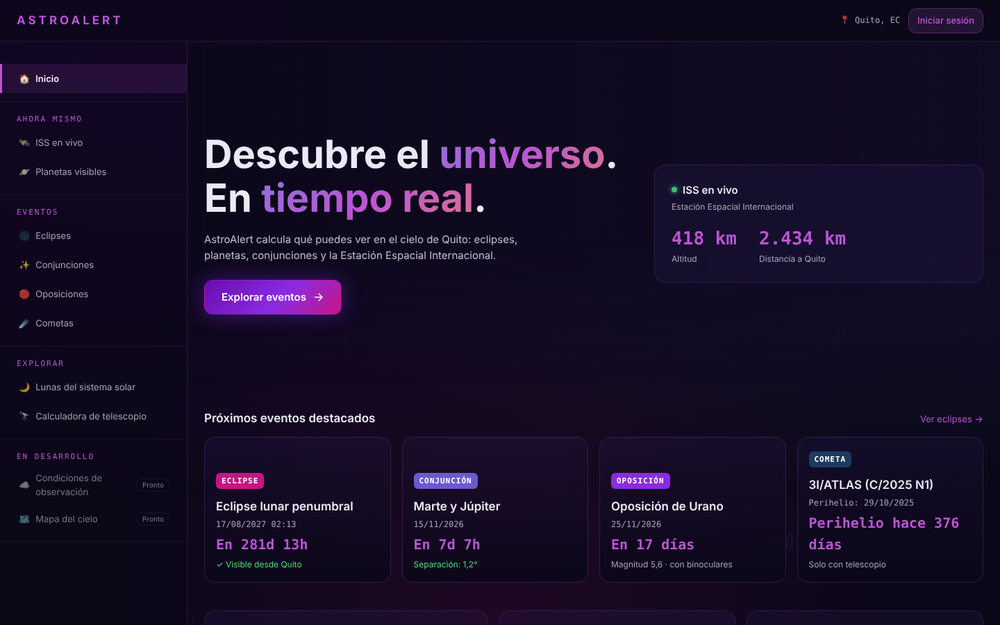
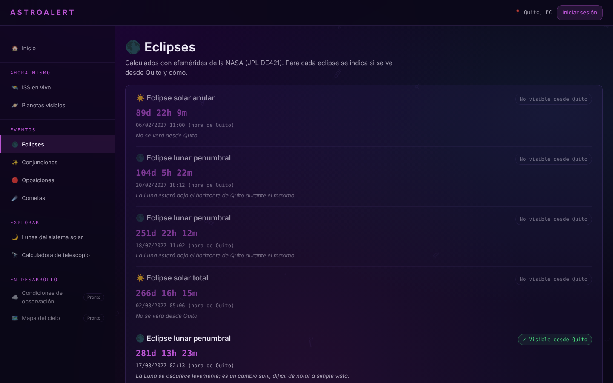
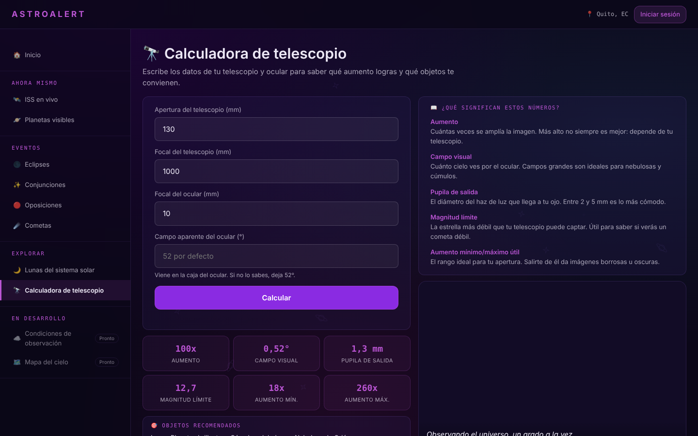
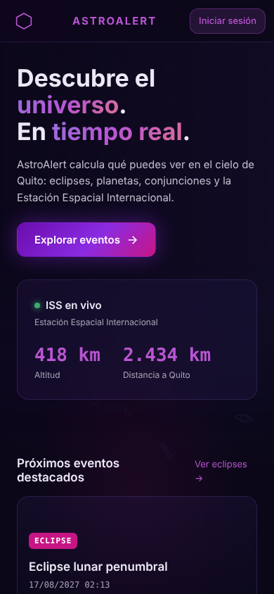
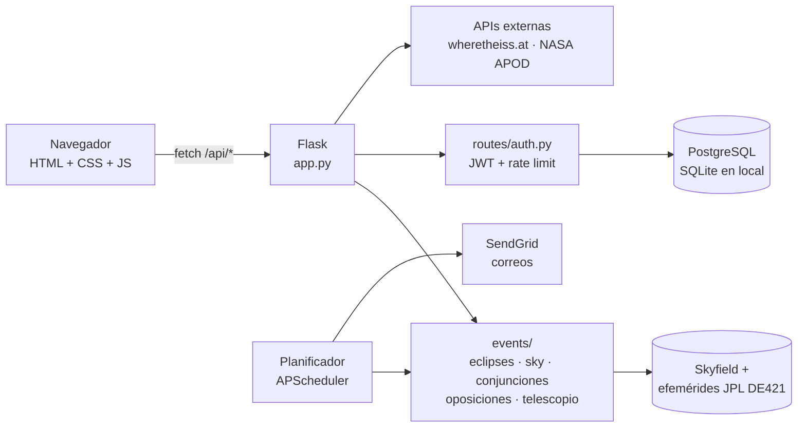

<div align="center">

# ⬡ AstroAlert

**Eventos astronómicos visibles desde Quito, calculados en tiempo real.**

Eclipses · planetas visibles · conjunciones · oposiciones · ISS en vivo · calculadora de telescopio

[](https://github.com/Ijloy/astroalert/actions/workflows/ci.yml)


<!-- Reemplaza por tu URL de Render después del deploy -->
**[🔗 Ver demo en vivo](#despliegue)**



</div>

---

## ¿Qué es?

AstroAlert responde una pregunta simple: **¿qué puedo ver hoy en el cielo de Quito?**

En lugar de mostrar tablas copiadas de otros sitios, **calcula** cada evento con efemérides de la NASA (JPL DE421) mediante la librería [Skyfield](https://rhodesmill.org/skyfield/), para la latitud, longitud y altura de Quito:

- 🌑 **Eclipses solares y lunares** con su visibilidad *local*: tipo (total, anular, parcial), porcentaje del Sol cubierto y horas de inicio, máximo y fin.
- 🪐 **Planetas visibles ahora**, solo cuando el cielo ya está oscuro, con dirección, altura y brillo.
- ✨ **Conjunciones** de planetas a menos de 3°, avisando si están demasiado cerca del Sol para verse.
- 🔴 **Oposiciones**: la mejor noche del año para observar cada planeta exterior.
- 🛰️ **ISS en vivo** y su distancia a Quito.
- 🔭 **Calculadora de telescopio**: aumento, campo visual, pupila de salida y objetos recomendados.
- 📧 **Alertas opcionales por correo**: resumen del cielo de cada noche y avisos de la ISS.

> *English summary:* AstroAlert is a Flask web app that computes astronomical events (eclipses with local circumstances, visible planets, conjunctions, oppositions, live ISS) for Quito, Ecuador, using NASA JPL ephemerides through Skyfield. Vanilla JS frontend, PostgreSQL, JWT auth, opt-in email alerts, 60 automated tests and CI.

## Capturas

| Eclipses con visibilidad desde Quito | Calculadora de telescopio | Móvil |
|---|---|---|
|  |  |  |

## Precisión: los cálculos están validados

Los resultados se comparan con datos publicados en los tests automáticos (`tests/test_astronomia.py`):

| Caso | Referencia | AstroAlert |
|---|---|---|
| Tipo de los eclipses solares 2027–2029 | NASA | ✅ 5 de 5 coinciden |
| Eclipse anular 26/01/2028 en Salinas (Ecuador) | Magnitud 0.917, anular | ✅ Magnitud 0.917, anular (~2 min 36 s) |
| Mismo eclipse visto desde Quito | Fuera de la franja anular | ✅ Parcial, 86 % del diámetro del Sol |
| Oposiciones de Urano, Júpiter y Marte (2026–2027) | 25/11/2026 · 10/02/2027 · 19/02/2027 | ✅ ±1 día |
| Planetas a mediodía | No visibles | ✅ Ninguno |

## Arquitectura



- **Backend:** Flask 3, SQLAlchemy, Flask-JWT-Extended, Flask-Limiter, APScheduler.
- **Astronomía:** Skyfield con efemérides JPL DE421 (incluidas en el repo, válidas de 1899 a 2053). Los resultados se guardan en caché entre 6 y 12 h: de ~2 s a ~2 ms por petición.
- **Frontend:** HTML, CSS y JavaScript sin frameworks. Usa URLs reales por sección (History API) y el sistema de diseño **Cosmic Glass** con la paleta *Cosmic Nebula* ([docs/Design](docs/Design)).
- **Accesibilidad:** 0 problemas en la auditoría automática WCAG 2.1 AA (axe-core); navegable con teclado y compatible con `prefers-reduced-motion`.

## Ejecutar en local

Requisitos: Python 3.12+.

```bash
git clone https://github.com/Ijloy/astroalert.git
cd astroalert
python -m venv venv
source venv/bin/activate        # Windows: venv\Scripts\activate
pip install -r requirements.txt
cp .env.example .env            # opcional: ajusta ciudad, claves, etc.
flask --app app run --debug
```

Abre http://localhost:5000. Sin `DATABASE_URL`, la app usa SQLite local.

### Tests y lint

```bash
pip install -r requirements-dev.txt
pytest          # 60 tests: cálculos, API, autenticación y alertas
ruff check .
```

Los tests no necesitan internet: las APIs externas se simulan.

## API

| Método | Ruta | Descripción |
|---|---|---|
| GET | `/api/health` | Estado del servicio y la base de datos |
| GET | `/api/iss` | Posición de la ISS y distancia a la ciudad |
| GET | `/api/planetas` | Planetas visibles ahora o próxima ventana, más el estado del cielo |
| GET | `/api/eclipses` | Eclipses con circunstancias locales |
| GET | `/api/conjunciones` | Conjunciones < 3° (próximos 4 meses) |
| GET | `/api/oposiciones` | Próxima oposición de cada planeta exterior |
| GET | `/api/cometas` | Cometas destacados recientes (datos verificados con fuente) |
| GET | `/api/lunas`, `/api/lunas/<id>` | Lunas del sistema solar |
| GET | `/api/imagen-dia` | Imagen astronómica del día (NASA APOD) |
| POST | `/api/telescopio` | Cálculos ópticos del telescopio |
| POST | `/api/registro`, `/api/login` | Cuenta (opcional, para alertas) |
| GET / PATCH | `/api/perfil`, `/api/perfil/alertas` | Perfil y preferencia de alertas (JWT) |

## Despliegue

El archivo [`render.yaml`](render.yaml) crea en [Render](https://render.com) la web y una base de datos PostgreSQL, genera las claves secretas y configura el *health check*:

1. En Render: **New → Blueprint** y elige este repositorio.
2. Opcional: añade `NASA_API_KEY` (gratis en https://api.nasa.gov).
3. Para alertas por correo: `SENDGRID_API_KEY`, `EMAIL_FROM` y `ENABLE_SCHEDULER=true`.

Todas las variables están documentadas en [`.env.example`](.env.example). En producción (`APP_ENV=production`) la app no arranca sin `SECRET_KEY` y `JWT_SECRET_KEY`.

## Estructura

```
astroalert/
├── app.py                 # Rutas web y API, errores, seguridad
├── config.py              # Configuración desde variables de entorno
├── extensions.py          # Rate limiter compartido
├── events/                # Cálculos astronómicos (uno por tipo de evento)
│   ├── efemerides.py      #   efemérides, observador, zona horaria y caché compartidos
│   ├── eclipses.py  sky.py  conjunciones.py  oposiciones.py
│   └── iss.py  cometas.py  lunas.py  telescopio.py  apod.py
├── routes/auth.py         # Registro, login, perfil y alertas
├── database/models.py     # Modelo Usuario
├── notifications/         # Correos (SendGrid) y planificador de alertas
├── templates/index.html   # Página única con todas las secciones
├── static/                # style.css (tokens Cosmic Glass) y app.js
├── tests/                 # pytest
└── docs/                  # Producto, diseño, UX, componentes y páginas
```

## Hoja de ruta

- [ ] Condiciones de observación por hora (nubosidad con Open-Meteo)
- [ ] Cometas en tiempo real desde JPL SBDB
- [ ] Pasos visibles de la ISS (predicción con TLE)
- [ ] Ubicación elegida por el usuario (hoy: Quito)
- [ ] Mapa del cielo interactivo

## Créditos

Efemérides: NASA JPL DE421 vía [Skyfield](https://rhodesmill.org/skyfield/) · ISS: [wheretheiss.at](https://wheretheiss.at) · Imágenes: [NASA Image Library](https://images.nasa.gov), [APOD](https://apod.nasa.gov) y Wikimedia Commons.

## Autor

**Dereck Proaño** — Estudiante de Ingeniería de Software, Universidad de las Américas (Quito).
GitHub: [@Ijloy](https://github.com/Ijloy)

Licencia [MIT](LICENSE).
